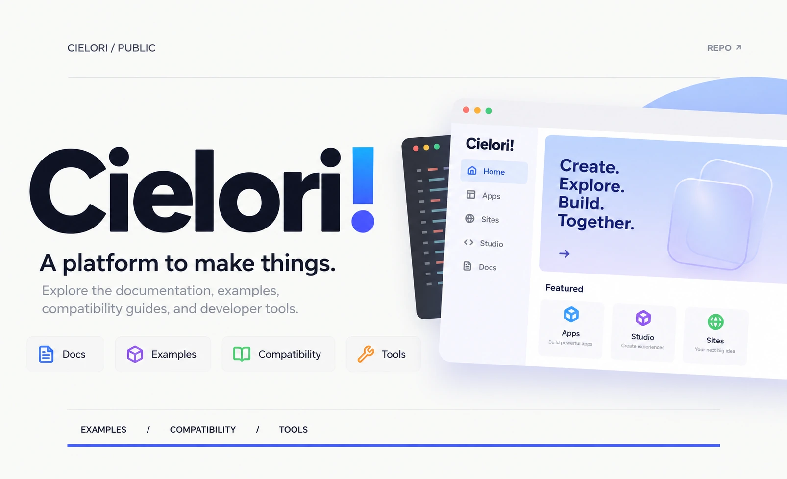

<p align="center">
  
</p>

# Cielori! — a platform to make things.

**An operating environment and creator platform built inside Roblox.** Open apps, explore sites, work with files—and, when you feel like making something yourself, build on the same platform.

This is **Cielori's public home for creators**: approachable guides, working source examples, API introductions and honest notes about what the platform supports. You don't need to understand operating-system internals to start here.

[**Start exploring →**](docs/getting-started/OVERVIEW.md) · [See an example](examples/web/basic/) · [What works?](docs/compatibility/CHECKLIST.md) · [Questions?](docs/getting-started/FAQ.md)

---

## What do you want to make?

| I want to… | Start here |
| --- | --- |
| **Make a website** | [Build your first Cielori page](docs/getting-started/BUILD_A_SITE.md) — familiar HTML and CSS, with Cielori-specific limits explained. |
| **Build an app** | [Meet the application platform](docs/getting-started/BUILD_AN_APP.md) — TypeScript-first authoring and Cielori APIs. |
| **See what works** | [Scan the compatibility checklist](docs/compatibility/CHECKLIST.md) — quick answers about HTML, CSS, scripting and apps. |
| **Understand Cielori** | [The quick tour](docs/getting-started/OVERVIEW.md) — no kernel vocabulary required. |

### A little preview

A Cielori site starts with recognizable web files, not a secret new syntax:

```html
<!doctype html>
<html lang="en">
  <head>
    <title>My little corner</title>
    <link rel="stylesheet" href="styles.css">
  </head>
  <body>
    <main>
      <h1>Hey, Cielori!</h1>
      <p>Made by me. Ready to grow.</p>
    </main>
  </body>
</html>
```

[See the complete HTML + CSS example →](examples/web/basic/)  
[Learn what happens next →](docs/getting-started/BUILD_A_SITE.md)

*Cielori supports a defined HTML/CSS profile, not every feature found in Chrome, Safari or Firefox.*

## What lives inside Cielori?

**Everyday things:** a desktop, windows, Files, a Browser, a Store and familiar navigation.  
**Creative things:** Sites for web projects, a Creator workflow, and **Loom** for making applications.  
**Underneath:** a permission-aware platform for apps, files, packages and Cielori's own `billow://` web.

It's one environment. You don't have to enter a special “developer mode” to be curious.

## A new name, the same creative platform

Cielori is the new name for the project previously known as **BillowOS**. Some technical names, such as `billow://`, `@billow/*` and `data-billow-*`, remain in the current documented platform contracts. **Don't rename those in your code** unless an official migration guide says to. [Learn why →](docs/reference/BRANDING_AND_API_NAMES.md)

## Where the project stands

Cielori is under active development. The core project's **internal testing** has accepted the TypeScript / JavaScript / Luau Creator path and an HTML/CSS Sites → Browser journey. That is **not** a claim that a public Roblox release is available or that every feature is stable.

| Area | The practical answer |
| --- | --- |
| **Web pages** | Standard HTML/CSS concepts, within [Cielori's documented profile](docs/web/README.md). |
| **Applications** | TypeScript is the default creator language; JavaScript and Luau are alternatives. Consult [application docs](docs/applications/README.md). |
| **Page scripting** | JavaScript/TypeScript integration is still feature-gated; don't assume an ordinary browser's full APIs. |
| **Older JML/JSS projects** | Legacy compatibility exists; **new work starts with HTML/CSS**. |
| **Compatibility** | Consult the [feature index](docs/compatibility/FEATURES.md) for exact support and limits. |

### A few things to know

- **Cielori runs inside Roblox.** It isn't an OS you install on your laptop or a standalone web browser.
- **Familiar doesn't mean identical.** HTML/CSS concepts transfer, but Cielori uses controlled rendering, APIs and permissions.
- **This is a public documentation repository**, not the private OS engine or a downloadable standalone runtime.
- **Public doesn't automatically mean open source.** [License information](LICENSE) is currently limited; don't assume permission to reuse the private implementation.

## The bookshelf

[**Documentation**](docs/README.md) · [**Website development**](docs/web/README.md) · [**App APIs**](docs/applications/README.md) · [**Files and resources**](docs/filesystem/README.md) · [**Compatibility checklist**](docs/compatibility/CHECKLIST.md) · [Full feature index](docs/compatibility/FEATURES.md) · [**Platform concepts**](docs/architecture/SYSTEM_OVERVIEW.md) · [**Terminology**](docs/getting-started/TERMINOLOGY.md)

Want to help with the public guides? [Read the contribution guide](CONTRIBUTING.md).  
Want to see what's next? [Roadmap](ROADMAP.md) · [Changelog](CHANGELOG.md).

---

<p align="center"><strong>Made by you. Owned by you.</strong><br/><sub>Built to be built on.</sub></p>
